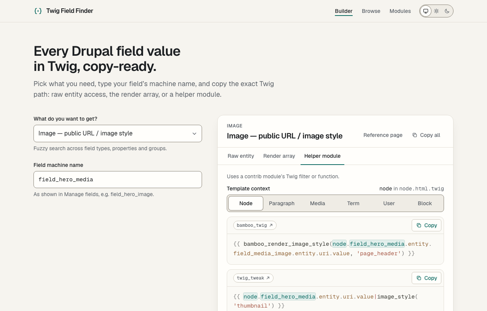

# Twig Field Finder

**Every Drupal field value in Twig, copy-ready.**

Pick what you need ("Image — alt", "Link — URL", "Reference — label"), type your field's machine
name, choose the template you're in, and copy the exact Twig path: raw entity access, the render
array, or a contrib helper module.

<picture>
  <source media="(prefers-color-scheme: dark)" srcset="docs/screenshot-dark.png">
  
</picture>

It started as my personal notes on getting field values in Twig. It is also a portfolio piece, so
the architecture, accessibility and performance get the same care as the features.

## Features

- **Snippet builder.** A fuzzy, grouped, fully keyboard-operable field-type picker. Field
  machine-name input with inline validation and a one-click `field_` prefix suggestion that never
  rewrites your input. Template context (node, paragraph, media, term, user, block). Approach tabs,
  syntax highlighting with your values marked, copy per snippet or all at once.
- **Shareable answers.** The builder state lives in the URL:
  `/?entry=link-url&field=field_cta&entity=taxonomy_term&tab=render`.
- **A static page per entry** (`/fields/[id]/`) with every approach, for search and direct links,
  each linking into the builder with the state prefilled.
- **Browse** every entry, filterable by group and contrib module, and a **helper modules** page.
- **Dark mode** that follows the system, with a manual System / Light / Dark switch.
- **Review mode** in development: entries I corrected or am unsure about show their verification
  note. Production builds leave the notes out, and a post-build check proves it.

## Tech decisions

| Decision                                                    | Why                                                                                                                                                                                                                                                                                                          |
| ----------------------------------------------------------- | ------------------------------------------------------------------------------------------------------------------------------------------------------------------------------------------------------------------------------------------------------------------------------------------------------------ |
| **Astro**, static output                                    | Content-first site: 80 pages of HTML, with JavaScript only where it earns its place.                                                                                                                                                                                                                         |
| **React island for the builder only**                       | The builder is the one genuinely stateful UI. Everything else is static HTML. Browse filters and static copy buttons are ~1 KB vanilla scripts that enhance the HTML, so without JavaScript nothing is missing and no control is dead.                                                                       |
| **TypeScript**, `astro/tsconfigs/strictest`                 | `noUncheckedIndexedAccess`, `exactOptionalPropertyTypes` and no `any`, enforced by typescript-eslint's strict type-checked rules.                                                                                                                                                                            |
| **Content collections**, one YAML file per entry            | Each entry is the unit of review: verifying a note on a real Drupal site touches one small file with a clean diff. YAML block scalars keep multi-line Twig readable. Zod validates the shape. Tests enforce what Zod can't express, such as `usesField` matching `__FIELD__`.                                |
| **Pure logic in `src/lib/`**                                | Placeholder substitution, entity mapping, field-name validation, URL state, search and filters are framework-free and unit-tested. Components stay thin.                                                                                                                                                     |
| **React Aria Components** for the combobox, tabs and radios | Grouped options need proper `role="group"` semantics and screen-reader-tested announcements. Headless UI's combobox has no group semantics and Radix has no combobox. Its locale strings are stripped to `en-US` at build time.                                                                              |
| **Fuse.js**                                                 | Weighted fuzzy search (label > group > id) where word order doesn't matter: "alt image" finds "Image — alt".                                                                                                                                                                                                 |
| **Shiki, fine-grained core**                                | Highlighting at build time on static pages, and lazily in the browser in the builder so snippets update as you type.                                                                                                                                                                                         |
| ↳ **Trimmed, precompiled Twig grammar**                     | The stock grammar pulls in ~2.3 MB of embedded languages (PHP, Ruby, Python, CSS, JS…). A generator keeps only the Twig rules (13 KB) and compiles every pattern to a native RegExp, so the browser needs Shiki's raw engine and no conversion library. A test proves identical tokens across every snippet. |
| ↳ **Vitesse, adjusted to WCAG AA**                          | Stock Vitesse light colours many tokens at 2.3–4.4:1. A generator keeps each colour's hue and moves only its lightness until it reaches 4.5:1 on our code background, and a test checks every token of every snippet in both themes.                                                                         |
| **Tailwind CSS v4** with design tokens                      | Colours are CSS variables that flip for dark mode, so components never need `dark:` variants. Every text pair is ≥ 4.5:1 and every control border ≥ 3:1.                                                                                                                                                     |
| **Astro Fonts API** (Geist, Geist Mono)                     | Self-hosted, with metric-matched fallbacks (no layout shift). Only the UI font is preloaded.                                                                                                                                                                                                                 |
| **Astro CSP**                                               | A Content-Security-Policy with hashed scripts on every page. Styles allow `'unsafe-inline'` because Shiki colours tokens with style attributes.                                                                                                                                                              |
| **Vitest + Playwright + axe-core**                          | Unit tests for the logic and data, browser tests for the flows, and automated WCAG checks on every page type in both themes.                                                                                                                                                                                 |

## Getting started

Requires **Node 24** (Astro 7 needs ≥ 22.22) and **pnpm** (version pinned in `package.json`,
installed through Corepack).

```sh
nvm use                 # reads .nvmrc
corepack enable         # provides the pinned pnpm
pnpm install
pnpm dev                # http://localhost:4321, review notes visible
```

### Scripts

| Script                                         | What it does                                                                             |
| ---------------------------------------------- | ---------------------------------------------------------------------------------------- |
| `pnpm dev`                                     | Dev server, with review notes shown.                                                     |
| `pnpm build` / `pnpm preview`                  | Production build into `dist/` and a local server for it.                                 |
| `pnpm verify`                                  | Everything CI's check job does: format, lint, typecheck, unit tests, build, dist checks. |
| `pnpm test` / `pnpm test:watch`                | Vitest unit and content tests.                                                           |
| `pnpm test:e2e`                                | Playwright against the production build (run `pnpm build` first).                        |
| `pnpm lint` / `pnpm typecheck` / `pnpm format` | ESLint, `astro check`, Prettier.                                                         |
| `pnpm verify:dist`                             | Fails if a review note shipped, or a URL escapes `BASE_PATH`.                            |
| `pnpm highlight:build`                         | Regenerates the trimmed Twig grammar and the AA themes in `src/highlight/`.              |
| `pnpm build:apache`                            | Build plus an `.htaccess` for shared hosting (see [Deployment](#deployment)).            |
| `pnpm deploy:cloudflare`                       | Build and deploy with Wrangler.                                                          |

### Environment variables

| Variable       | Default                 | Purpose                                                                                               |
| -------------- | ----------------------- | ----------------------------------------------------------------------------------------------------- |
| `SITE_URL`     | `http://localhost:4321` | Absolute origin for canonical and Open Graph URLs. Set it in production.                              |
| `BASE_PATH`    | `/`                     | Path prefix when served from a subpath, e.g. `/twig-field-finder`.                                    |
| `PUBLIC_GA_ID` | unset                   | Google Analytics measurement ID (`G-…`). When set, adds gtag.js and opens the CSP for Google's hosts. |

## Project structure

```
src/
  content/
    entries/<group>/<id>.yaml   one file per field entry
    groups.yaml                 groups and their display order
    modules.yaml                contrib modules
    helper-filters.yaml         Twig Field Value's filters
  content.config.ts             Zod schemas
  data/entries.ts               the only reader of the collections (strips review notes in prod)
  lib/                          pure, tested logic
  components/builder/           the React island
  components/*.astro            static UI
  scripts/                      small vanilla enhancements (copy, filters, theme)
  highlight/                    Shiki setup, generated grammar and themes
  pages/                        builder, /fields/, /fields/[id]/, /modules/, 404
scripts/                        generators and post-build checks
e2e/                            Playwright and axe tests
```

## Adding an entry

1. Create `src/content/entries/<group>/<id>.yaml`. The filename is the id, and the folder must
   match `group`:

   ```yaml
   # src/content/entries/text/text-plain.yaml
   label: Text (plain, plain long)
   group: text # an id from groups.yaml
   order: 30 # position within the group; steps of 10 leave room
   raw: # entity access, before formatters
     - '{{ __ENTITY__.__FIELD__.value }}'
   render: # the content render array, after formatters
     - "{{ content.__FIELD__[0]['#context'].value }}"
   helper: # contrib module syntax
     - code: "{{ content.__FIELD__|field_value|first['#context'].value }}"
       module: twig_field_value # an id from modules.yaml
   ```

   Optional keys: `usesField: false` (see below), `notes` (shown under the result as a gotcha;
   supports `inline code`) and `review` (what to verify; shown in development only).

2. Placeholders:
   - `__ENTITY__` becomes the template's entity variable (`node`, `paragraph`, `media`, `term`,
     `user`, or `content['#block_content']`). The mapping lives in `src/lib/entities.ts`.
   - `__FIELD__` becomes the field machine name.
   - `__SUBFIELD__` becomes a field on the referenced entity, and shows an extra input.

   Snippets starting with `content.` don't depend on the entity. For entries without a field
   name (ID, title, bundle…), set `usesField: false`.

3. Run `pnpm test`. The content tests check the folder and group, known modules, unique ids and
   order, `usesField` against `__FIELD__`, `__SUBFIELD__` only with `__FIELD__`, and no misspelt
   placeholders. Every snippet is also highlighted and contrast-checked.

**New group:** add it to `groups.yaml` with an `order`. **New module:** add it to `modules.yaml`
with a name, a drupal.org URL and a one-line description.

### Data provenance and review

The content started as my notes exported from Confluence and was imported once into
`src/content/`, which is now the source of truth. The original export, the import script and the
project brief are in the git history (`git log --all -- data/`).

Entries with a `review` note were corrected during conversion, or need checking on a real Drupal
10/11 site. They're marked in the dev server's picker and on their pages. To clear one, verify
the snippet, fix it if needed, and delete the `review` line.

## Testing

- **Unit and content tests:** `pnpm test`, Vitest, about 880 tests.
- **End-to-end:** `pnpm build && pnpm test:e2e`, Playwright at desktop width and on a 360 px
  mobile viewport.
  - **What it covers:** builder flows, shareable URLs, copy and its announcement, static pages,
    browse filters, the no-JavaScript fallback, horizontal overflow, theme persistence (including
    blocked storage), focus rings, CSP violations, and regressions.
- **Accessibility:** axe-core (WCAG 2.0–2.2 A/AA plus best practices) on every page type in both
  themes, with the picker open and with an invalid input.
  - **One exception:** while the picker is open, React Aria hides the rest of the page from
    assistive tech, which is the correct combobox behaviour. Three page-structure rules are
    skipped for that state only, with the reason in the test.
- **Lighthouse** (13.5, production build):

  | Page                   | Mobile                | Desktop               |
  | ---------------------- | --------------------- | --------------------- |
  | Builder                | 97 / 100 / 100 / 100  | 100 / 100 / 100 / 100 |
  | Entry, browse, modules | 100 / 100 / 100 / 100 | 100 / 100 / 100 / 100 |

  Scores are performance / accessibility / best practices / SEO. The builder loads about 143 KB
  of gzipped JavaScript: React, React Aria and Fuse. Highlighting (about 42 KB) loads after the
  page appears. Static pages ship about 1 KB.

## Deployment

The build output in `dist/` is plain static files. CI builds it both at the root and under a
subpath, and checks that every URL respects the base path.

### Cloudflare (recommended)

Cloudflare now recommends **Workers with static assets** for new static sites. `wrangler.jsonc`
is set up for that: it serves `dist/`, returns `404.html` with a 404 status, and redirects to
trailing slashes. `public/_headers` adds security headers and long-lived caching for hashed
assets.

- **Git integration (Workers Builds):** connect the repository, set the build command to
  `pnpm build` and the deploy command to `npx wrangler deploy`, and add the environment variable
  `SITE_URL=https://your-domain`.
- **From your machine:** `SITE_URL=https://your-domain pnpm deploy:cloudflare` (asks you to log
  in to Wrangler the first time).

**Cloudflare Pages** works too, with the same `_headers` file:

| Setting                | Value                                                  |
| ---------------------- | ------------------------------------------------------ |
| Framework preset       | Astro                                                  |
| Build command          | `pnpm build`                                           |
| Build output directory | `dist`                                                 |
| Environment variables  | `SITE_URL=https://your-domain`, `PNPM_VERSION=12.14.0` |

The Pages build image reads `.nvmrc` for Node. It doesn't read pnpm's version from
`package.json`, hence `PNPM_VERSION`.

Both serve from the root of a domain or subdomain, so leave `BASE_PATH` unset.

### Shared hosting under a subpath (Apache)

```sh
BASE_PATH=/twig-field-finder SITE_URL=https://myname.com pnpm build:apache
```

Upload the **contents** of `dist/`, including the generated `.htaccess`, to
`public_html/twig-field-finder/`. The `.htaccess` sets the 404 page for that path, security
headers, long caching for `/_astro/`, revalidation for HTML, and compression. Apache's default
`DirectorySlash` handles trailing slashes. The Cloudflare `_headers` file is removed from this
build.

For a subdomain over SSH, `pnpm deploy:ssh` builds and uploads in one step (no `rsync` needed on
the server). Set `DEPLOY_HOST`, `DEPLOY_PATH`, `SITE_URL` and `PUBLIC_GA_ID` to override the
defaults in `scripts/deploy-ssh.sh`. It replaces the previous deploy but keeps cPanel's
`.well-known`, `cgi-bin`, `php.ini` and `.user.ini`.

On **nginx**, a starting point (adjust the paths to your server):

```nginx
location /twig-field-finder/ {
  alias /var/www/twig-field-finder/;
  try_files $uri $uri/ $uri/index.html =404;
  error_page 404 /twig-field-finder/404.html;
}
location /twig-field-finder/_astro/ {
  alias /var/www/twig-field-finder/_astro/;
  add_header Cache-Control "public, max-age=31536000, immutable";
}
```

## Continuous integration

`.github/workflows/ci.yml` runs on every push and pull request:

1. **check:** format, lint, typecheck, unit tests, a subpath build and a root build, each verified
   by `verify:dist`.
2. **e2e:** Playwright and axe against the root build, on desktop and mobile. The report is
   uploaded on failure.

## Credits

- Twig grammar from [shikijs/textmate-grammars-themes](https://github.com/shikijs/textmate-grammars-themes)
  (MIT), trimmed.
- [Vitesse](https://github.com/antfu/vscode-theme-vitesse) themes by Anthony Fu (MIT), adjusted
  for contrast.
- [Geist and Geist Mono](https://vercel.com/font) by Vercel (SIL Open Font License).

## License

[MIT](LICENSE) © 2026 Dejan Aleksic
